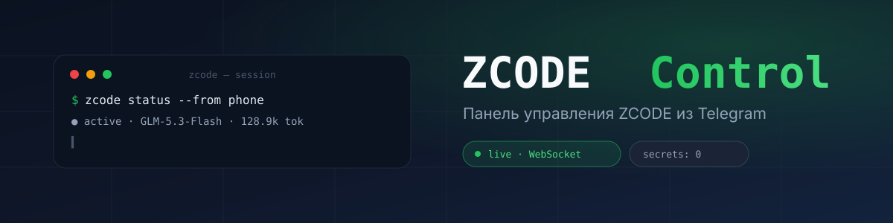

<div align="center">



# ZCODE Control

**Панель управления [ZCODE](https://z.ai) из Telegram** — сессии, задачи, диалоги, статистика токенов. Telegram Mini App без бэкенда в облаке: статика на GitHub Pages, данные остаются на вашем компьютере.

[](https://github.com/ivan-cruzzz/zcode-control/actions/workflows/deploy.yml)
[](LICENSE)


**[Открыть в Telegram](https://t.me/MyWzcode_bot)** · **[Веб-демо](https://ivan-cruzzz.github.io/zcode-control/)** · **[Как это работает](#-архитектура)**

</div>

---

## Что это

Мини-апп для Telegram (Vite + React + Tailwind, дизайн по принципам Apple HIG и минимализма: монохром + один акцент, плавающий док, тёмный AI prompt box от [kokonutui](https://kokonutui.com)), который показывает, чем занят ZCODE на вашем ПК, и позволяет управлять им с телефона:

- **Обзор** — живой статус (активен / простаивает), текущая сессия, модель и режим, токены за сегодня, лента последней активности; сверху — **мастер «Подключение ZCODE»**: живой чек-лист (мост → база ZCODE → владелец → бот привязан к ZCode → поллинг) с кнопками действий и пошаговой инструкцией;
- **Сессии** — список последних сессий с метками `live` / `готово` / `прервана`; внутри — задачи (todo), диалог пользователя с ассистентом и использованные инструменты;
- **Поиск** — в той же вкладке: фильтр по названиям + полнотекстовый поиск по сообщениям всех сессий;
- **Боты** — управление ботами ZCode с телефона, как в панели Bots на компьютере:
  вкл/выкл поллинга, гранулярность ответов (стандартный / подробный / кратко / живая карточка),
  доступ к проектам, разрешённые команды, переименование, удаление, статус поллинга и проверка токена BotFather;
- **Консоль** — командная строка пульта на компоненте [@kokonutui/ai-prompt](https://kokonutui.com) со slash-меню: `/help`, `/status`, `/sessions`, `/bots`, `/stats`, `/setup`, `/goto`, `/theme`, `/clear` (это команды пульта; команды самому ZCODE — в чат бота);
- **Статистика** — график токенов за 7 дней и метрики на Обзоре;
- **Демо-режим** — если мост не подключён, приложение показывает сгенерированные данные, так что интерфейс можно посмотреть сразу.

Без Telegram приложение тоже работает — откройте [веб-демо](https://ivan-cruzzz.github.io/zcode-control/).

## Архитектура

```
┌─────────────┐   HTTPS/WSS    ┌──────────────────┐   read-only    ┌────────────────┐
│  Telegram    │ ─────────────▶ │  Локальный мост   │ ─────────────▶ │  База ZCODE     │
│  Mini App    │   JSON + WS    │  (server/, ваш ПК)│    SQLite      │  db.sqlite      │
│  (GitHub     │ ◀───────────── │  проверка подписи │                │  session, todo, │
│   Pages)     │  live-события  │  initData HMAC    │                │  message, usage │
└─────────────┘                └──────────────────┘                └────────────────┘
```

- **Мини-апп** (`app/`) — статика: HTML/CSS/vanilla JS, без сборки и зависимостей. Хостится на GitHub Pages.
- **Мост** (`server/`) — маленький Node-сервер, который вы запускаете на своём компьютере. Читает базу ZCODE **только для чтения** и отдаёт данные мини-аппу через туннель (cloudflared / ngrok / tailscale).
- **Живые обновления** — WebSocket: новые сообщения и задачи прилетают в телефон за секунды. Если WS недоступен, клиент автоматически переходит на опрос раз в 12 секунд.

## Безопасность

Главная идея: **секретов в клиенте и репозитории нет и быть не может**.

| Где | Что | Почему безопасно |
|---|---|---|
| `server/.env` | токен бота | Файл в `.gitignore`, существует только на вашем ПК |
| Мини-апп | ничего | Авторизация — через подписанный Telegram `initData` |
| Репозиторий | ничего | В CI уезжает только статика из `app/` |
| `~/.zcode/v2/credentials.json` | токены ботов ZCode | Зашифрованы самим ZCode (`enc:v1`); мост **не умеет** их читать и не логирует — только удаляет ключ при удалении бота |

Как устроена авторизация: Telegram подписывает `initData` ключом, выведенным из токена бота. Мост проверяет HMAC-SHA256 подпись, свежесть (по умолчанию ≤ 24 ч) и **закрепление владельца**: при первом входе в мини-апп нажмите «Закрепить этот аккаунт за мостом» — после этого мост отвечает только вашему Telegram ID (хранится в локальном `server/.owner.json`, в git не попадает). Все запросы других аккаунтов отклоняются с 403, даже с валидной подписью. Сбросить привязку можно, удалив `server/.owner.json`.

Боты ZCode дополнительно защищены самим ZCode: бот привязывается к приватному чату владельца (`privateBindingId`), поэтому командовать ботом может только его владелец; набор доступных боту команд (`/status`, `/new`, смена модели и т.д.) настраивается во вкладке «Боты».

Про «полный контроль»: у ZCode нет внешнего API (локальные порты закрыты, очередь ввода сессий — внутренняя), поэтому удалённо нельзя ввести текст в чужую сессию в обход архитектуры. Практически полный контроль с телефона складывается из двух частей: **мини-апп** — мониторинг, управление ботами и конфигурацией; **чат с ботом** — прямые команды ZCODE (это штатный канал самого ZCode, уже привязанный только к вам).

Дополнительно: CORS-allowlist (по умолчанию только ваш GitHub Pages и localhost), rate-limit, ограничение размера запроса, `timingSafeEqual` при сравнении подписей.

> **Совет:** токен бота вы когда-то вставляли в чаты/скрипты? Перевыпустите его у @BotFather (`/revoke`) и обновите `server/.env` — это одна минута.

## Быстрый старт

**Подключение в два касания.** Мост теперь сам поднимает туннель и сам присылает адрес:

1. **Мост.** Нужен Node ≥ 22.5:
   ```bash
   cd server
   cp .env.example .env        # впишите BOT_TOKEN от @BotFather
   npm install
   npm start
   ```
   Мост найдёт cloudflared (положите бинарник в `server/bin/cloudflared.exe` или установите `winget install Cloudflare.cloudflared`), поднимет HTTPS-туннель и начнёт слушать `/start` в боте.
2. **Нажмите кнопку.** Напишите боту `/start` — он пришлёт кнопку «Открыть ZCODE Control» с адресом туннеля внутри. Тап — мини-апп открывается **уже подключённым** (адрес передаётся через `start_param` и сохраняется). При каждом перезапуске моста придёт новая кнопка — тапните её, адрес обновится.
3. **Привязать бота к ZCODE** (для команд боту): по кнопке «Привязать» в мастере на Обзоре — ZCode → панель Bots → New bot → вставьте токен → включите. Как только ZCode сам начнёт опрашивать бота, мост автоматически уступит опрос (конфликт 409 обрабатывается), туннель продолжит работать.

Ручной способ (если автотуннель не нужен): `--no-expose` у моста, любой туннель отдельно, адрес — в Настройках мини-аппа.

### Кнопка меню у бота

Чтобы приложение открывалось кнопкой меню в чате с ботом (у [этого бота](https://t.me/MyWzcode_bot) уже настроено), отправьте в любом HTTP-клиенте:

```
POST https://api.telegram.org/bot<TOKEN>/setChatMenuButton
{ "menu_button": { "type": "web_app", "text": "ZCODE Control",
                   "web_app": { "url": "https://ivan-cruzzz.github.io/zcode-control/" } } }
```

## API-контракт моста

Если хотите подключить мини-апп к своему каналу данных (не через SQLite), реализуйте эти методы — и всё заработает:

| Метод | Тело запроса | Ответ |
|---|---|---|
| `POST /api/auth` | `{initData}` | `{ok, user:{id, first_name, username}, mode}` |
| `POST /api/overview` | `{initData}` | `{ok, status:{state, model, mode, updatedAt, session}, stats:{sessions, sessionsToday, tokensToday, todosActive}, activity:[{sessionId, sessionTitle, time, text}]}` |
| `POST /api/sessions` | `{initData, limit}` | `{ok, sessions:[{id, title, directory, timeUpdated, outcome, tokens}]}` |
| `POST /api/session` | `{initData, id}` | `{ok, session, todos, messages, tools}` |
| `POST /api/search` | `{initData, q, limit}` | `{ok, results:[{sessionId, sessionTitle, time, text}]}` |
| `POST /api/stats` | `{initData, days}` | `{ok, daily:[{date, tokens, sessions}], models, tools}` |
| `POST /api/bots` | `{initData}` | `{ok, bots:[…], polling}` — список ботов ZCode + статус поллинга |
| `POST /api/bot/update` | `{initData, id, patch}` | `{ok, updated}` — patch: `enabled, name, replyMode, allowedWorkspaces, allowedCommands` |
| `POST /api/bot/delete` | `{initData, id}` | `{ok, deleted}` — удаляет бота и ключ его токена из credentials |
| `POST /api/bot/link` | `{initData, token}` | `{ok, verified, username, alreadyLinked, hint}` — проверка токена через getMe |
| `POST /api/projects` | `{initData}` | `{ok, projects:[{id, directory}]}` |
| `POST /api/pair` | `{initData}` | `{ok, paired}` — закрепляет первый аккаунт как владельца моста |
| `POST /api/setup` | `{initData}` | `{ok, bridge, ownerPaired, bot:{verified, username, linkedInZcode, polling}}` — состояние мастера подключения |
| `WS /ws` | `{type:"auth", initData}` | `{type:"auth_ok"}`, далее `{type:"refresh", scope, id?}` |

`replyMode` принимает значения ZCode: `assistant_changes` (стандартный), `assistant_toolcalls_changes`, `summary_changes`, `streaming_card`.

`time*` — epoch-миллисекунды; `outcome` — `completed | interrupted | null`. Референсная реализация — `server/adapter-zcode.mjs`.

## Структура проекта

```
├── app/                    # мини-апп: Vite + React + Tailwind v4, shadcn/kokonutui
│   ├── index.html
│   ├── src/
│   │   ├── App.tsx         # состояние, навигация, подключение к мосту
│   │   ├── views/          # Обзор, Сессии, Консоль, Боты, Настройки
│   │   ├── components/     # плавающий док, график, чек-лист, kokonutui/ai-prompt
│   │   └── lib/            # клиент моста, команды консоли, Telegram-хук, форматтеры
│   └── dist/               # сборка (CI, в git не попадает)
├── server/                 # мост (запускается на вашем ПК)
│   ├── bridge.mjs          # HTTP/WS, проверка initData, CORS, rate-limit
│   ├── adapter-zcode.mjs   # чтение базы ZCODE (read-only SQLite)
│   ├── bot-manager.mjs     # управление ботами ZCode (bot-config.v3.json)
│   ├── adapter-demo.mjs    # демо-адаптер
│   ├── .env.example        # шаблон конфига (без секретов)
│   └── .env                # ← ваши секреты (в git не попадает)
├── docs/banner.svg
└── .github/workflows/deploy.yml
```

## Деплой

Статика публикуется на GitHub Pages автоматически при push в `main` (`.github/workflows/deploy.yml`). Для собственного форка:

1. Settings → Pages → Source: **GitHub Actions**;
2. если меняете адрес сайта — добавьте его в `ALLOWED_ORIGINS` моста (`server/.env`);
3. при желании обновите кнопку меню бота (см. выше).

## FAQ

**Мост запущен, но «нет связи».** Проверьте: адрес в настройках начинается с `https://`; туннель живой; origin вашего сайта есть в `ALLOWED_ORIGINS`; `curl https://<туннель>/health` отвечает.

**«Авторизация Telegram не пройдена: expired».** Откройте мини-апп заново из Telegram — initData подписывается при каждом открытии и по умолчанию живёт сутки (`MAX_AUTH_AGE`).

**Данные кто-то ещё увидит?** Без валидной подписи Telegram — нет. Для дополнительной страховки задайте `ALLOWED_USER_IDS` в `server/.env`.

**SQLite ошибка при старте.** Мост открывает базу в read-only и не мешает ZCODE. Проверьте путь `ZCODE_DB` в `server/.env`, если база нестандартная.

**Изменил бота с телефона, а он не отреагировал.** Мост правит тот же `bot-config.v3.json`, что и панель Bots. Если ZCode не подхватил изменение на лету — переоткройте панель Bots (или перезапустите ZCode) один раз.

**Почему нельзя привязать новый токен прямо с телефона?** ZCode шифрует токены собственным ключом (`enc:v1`), воспроизвести это шифрование извне нельзя — так безопаснее. Мини-апп проверяет токен через Telegram (getMe), а вставить его в панель Bots нужно один раз на компьютере. Всё остальное управление — полностью с телефона.

**Сбросить владельца моста.** Удалите `server/.owner.json` и перезапустите мост — при следующем входе в мини-апп мост можно закрепить за другим аккаунтом.

**Может ли кто-то ещё пользоваться ботом?** Нет: ZCode привязывает бота к приватному чату владельца, а мост после закрепления отвечает только вашему Telegram ID. Оба барьера действуют одновременно.

---

<div align="center">

Сделано с ♥ и [ZCODE](https://z.ai) · [MIT](LICENSE) · 2026

</div>
